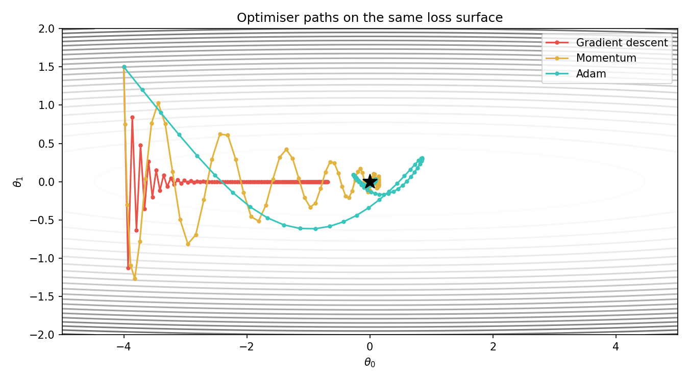

# Optimisers

Gradient descent, Momentum and Adam implemented from scratch with NumPy. All three optimisers are run on the same poorly conditioned loss surface so the differences are easy to see. The picture below shows visualisation of how the optimisers move across the surface towards the minimum of the loss $L(\theta)$. The model has two parameters, $\theta = (\theta_0, \theta_1)$, which form the horizontal and vertical axes of the picture. Each point in the plane is one choice of parameter values, and the contour lines connect points with the same loss, so the loss is lowest at the centre of the ellipses. Contours are close together along the steep direction and far apart along the flat direction. Every optimiser starts from the same initial point, and its path shows how $(\theta_0, \theta_1)$ changes after each step. Gradient descent is stable, but progress in the flat direction is slow. Momentum is faster, but overshoots the optimum and oscillates. Adam is fast because step size adapts per parameter; slight overshoot then quick settling. Star shows the optimised value.



---

## Relation to Artificial Intelligence

Every neural network — from a small CNN classifying images to a multi-billion-parameter large language model — is trained by repeatedly taking optimiser steps. Adam (and its variants AdamW, Lion) is the default optimiser in virtually all modern training runs of transformers, diffusion models and vision networks. Understanding why plain gradient descent struggles on ill-conditioned surfaces, and how momentum / adaptive scaling help, is foundational to training any deep model successfully. When one calls `optimizer.step()` in PyTorch, the framework applies exactly the update rules derived in this project (gradient descent, momentum or Adam, e.g. `torch.optim.SGD` and `torch.optim.Adam`) to every parameter of the model, using the gradients that backpropagation has just computed.

## Mathematics

Training is an optimisation problem: find parameters $\theta=(\theta_0,\theta_1)$ that minimise a loss $L(\theta)$.

<ins>1. Gradient descent</ins>

The gradient $\nabla_\theta L$ points in the direction of steepest ascent, so we step in the opposite direction as

$\theta \leftarrow \theta - \eta\,\nabla_\theta L(\theta)$,

where $\eta$ is the learning rate.

Why choosing $\eta$ is hard? Consider the quadratic surface $L = \tfrac12(a x^2 + b y^2)$ with $a \ll b$. After one GD step the coordinates are multiplied by $(1-\eta a)$ and $(1-\eta b)$. For the steep direction not to explode we need $\lvert 1-\eta b\rvert < 1$, i.e.

$\eta < \frac{2}{b}$.

But then in the flat direction the factor is $1-\eta a \approx 1$ and progress is slow. The condition number $\kappa = b/a$ quantifies how bad the situation is. In this demo $\kappa = 100$.

<ins>2. Momentum</ins>

We accumulate a velocity that remembers previous gradients as

$u_t = \beta\,u_{t-1} + g_t$,

and update the parameters as

$\theta \leftarrow \theta - \eta\,u_t$,

where $g_t = \nabla_\theta L(\theta_{t-1})$. In the steep direction the gradient sign oscillates and the sum cancels; in the flat direction gradients point the same way and accumulate. For a constant gradient the effective step size becomes

$\eta\,\sum_{k\ge 0}\beta^k = \frac{\eta}{1-\beta}$,

so $\beta = 0.9$ gives roughly a 10× larger step in the flat direction.

<ins>3. Adam</ins>

Adam keeps running estimates of both the first moment (mean) and the second moment (uncentred variance) of the gradient as

$m_t = \beta_1 m_{t-1} + (1-\beta_1)\,g_t,\qquad v_t = \beta_2 v_{t-1} + (1-\beta_2)\,g_t^2$.

Because $m_0 = v_0 = 0$ the estimates are biased toward zero at the beginning. Bias correction is

$\hat m_t = \frac{m_t}{1-\beta_1^t},\qquad \hat v_t = \frac{v_t}{1-\beta_2^t}$.

The update is

$\theta \leftarrow \theta - \eta\,\frac{\hat m_t}{\sqrt{\hat v_t}+\epsilon}$.

Dividing by $\sqrt{\hat v_t}$ normalises the step size of every parameter individually: parameters that receive large gradients move cautiously, those with small gradients move more boldly. This is why Adam works well without having to hand-tune a learning rate for every direction.

## Running

```bash
pip install -r requirements.txt
python main.py
```

## References

Zhang, A., Lipton, Z. C., Li, M. & Smola, A. J. (2023). “Optimization Algorithms” [Chapter 9]. Dive into Deep Learning. Available at: https://d2l.ai/chapter_optimization/